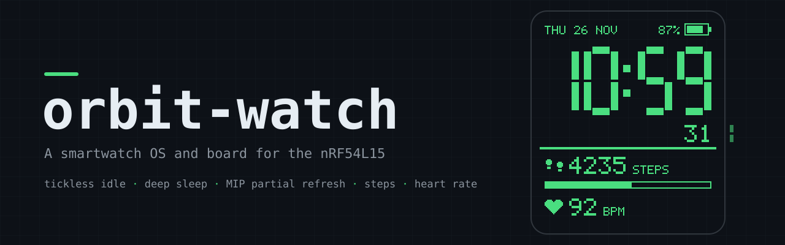
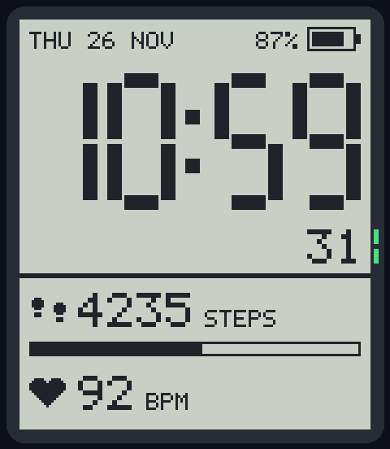
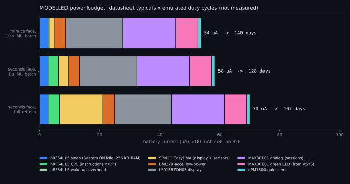
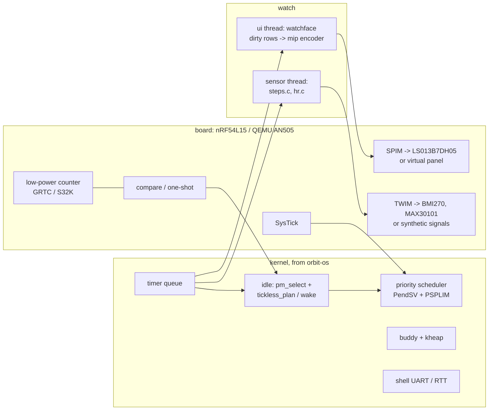
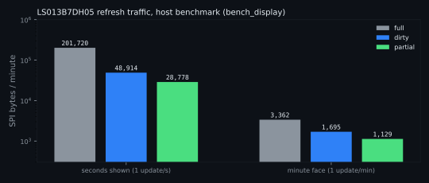
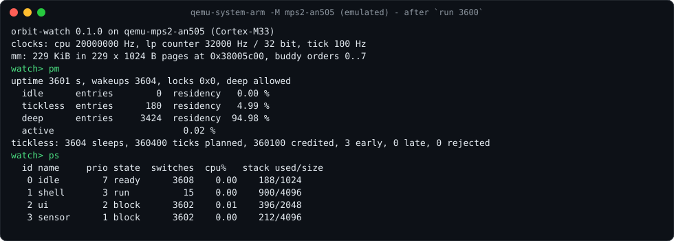
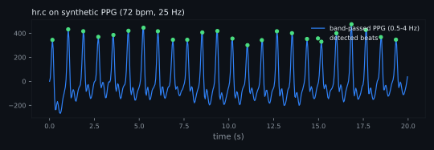

<p align="center">
  
</p>

<p align="center">
  <a href="https://github.com/coopersimpson101-debug/orbit-watch/actions/workflows/ci.yml"></a>
  <a href="https://github.com/coopersimpson101-debug/orbit-watch/releases/latest"></a>
  <a href="LICENSE"></a>
  
  
  
</p>

**A smartwatch of my own: an nRF54L15 board designed as code, and a low-power OS derived from
[orbit-os](https://github.com/coopersimpson101-debug/orbit-os) that sleeps through almost all of
its life.** The kernel does tickless idle, deep sleep and memory-LCD partial refresh, and the
watch counts steps and measures heart rate with its own signal processing. It runs today under
QEMU (Cortex-M33) in CI. The board exists as a checked netlist and BOM, and is waiting to be
laid out and built.

<p align="center">
  <a href="#quickstart">Quickstart</a> ·
  <a href="#how-it-works">How it works</a> ·
  <a href="#results">Results</a> ·
  <a href="docs/hardware.md">Hardware</a> ·
  <a href="#hardware-validation--todo-for-the-author">Hardware TODO</a> ·
  <a href="#roadmap">Roadmap</a>
</p>

<p align="center">
  
  &nbsp;&nbsp;
  
</p>
<p align="center"><sub><b>Left:</b> the panel memory after one hour of emulated running
(<code>qemu-system-arm -M mps2-an505</code>, 26 Nov 2026). Every SPI frame the firmware sent was
decoded bit by bit by a model of the Sharp LS013B7DH05 and dumped with <code>snap</code>. The
green ticks mark the 12 rows that one seconds update (:42 to :43, rendered on the host) resends. Steps and heart rate come
from the firmware's own algorithms running on synthetic sensor signals. <b>Right:</b> a
<b>modelled</b> power budget (datasheet typical currents × duty cycles measured in the emulated
run × stated assumptions; no BLE). It is not a measurement: see
<a href="tools/power_budget.py">tools/power_budget.py</a>.</sub></p>

## Highlights

- **Tickless idle with zero drift.** Kernel time is slaved to the low-power counter through one
  fixed anchor, so the 327.68-cycles-per-tick fraction never accumulates. A soak test of 448,845
  random sleeps over four counter configurations (24-bit RTC to 52-bit GRTC) checks every wake-up.
  In an emulated hour the watch woke **3,603 times (once per second) and spent 94.98 % of the
  time in `PM_DEEP`** with the seconds shown. With the minute face it woke 527 times.
- **Partial refresh that pays off.** Dirty-row tracking plus identical-row suppression cuts SPI
  traffic to the memory LCD from **201,720 to 28,778 bytes per minute (7.0×)** with seconds
  shown, and from 3,362 to 1,129 bytes per minute (3.0×) on the minute face. These are host
  benchmark figures, and every frame was verified against the reference panel decoder.
- **Kernel ported from orbit-os to Cortex-M33:** PendSV context switch, per-thread PSPLIM stack
  limits, an 8-level priority run-queue, event flags, a kernel timer queue, the buddy + slab
  allocator with 1 KiB pages, and a shell over UART or SEGGER-RTT-compatible memory. The image
  is about 25 KB.
- **Heart rate from PPG, integer-only:** a Butterworth band-pass designed with the bilinear
  transform, sub-sample peak interpolation and median inter-beat intervals. On 8 real fingertip
  PPG recordings from the BIDMC dataset it gets **0.05 to 1.7 bpm mean absolute error** against
  the ECG-derived HR.
- **Step counter, integer-only:** within **0.5 %** of ground truth on synthetic gait from 1.5 to
  2.8 Hz (50 min per case), 0 false steps at rest or typing, and **4,235 steps vs 4,229 true** in
  the emulated hour.
- **A board designed as code:** nRF54L15 + nPM1300 + BMI270 + MAX30101 + Sharp LS013B7DH05 in
  SKiDL. It produces a KiCad netlist, a 43-line BOM with MPNs and official footprints, and an ERC
  with 0 messages. Project design checks (rail voltages vs datasheet limits, I2C addresses,
  nRF54L15 pin rules, footprint pads) end with 0 failures.

## Status

| | what | how it was checked |
|---|---|---|
| ✅ | Firmware builds for `an505` and `nrf54l15` with zig cc, `-Werror` | locally (Windows) and in CI (Linux, macOS) |
| ✅ | 14 C unit-test programs: tickless, PM policy, timers, MIP encoder/decoder, watchface, steps, HR, RTT, allocators (incl. orbit-os's tests) | locally and in CI |
| ✅ | HR on 8 BIDMC PPG excerpts; step and HR sweeps on synthetic signals | locally and in CI |
| ✅ | Schematic: SKiDL netlist, BOM, ERC (0 messages), design checks (0 failures, 4 warnings) | locally and in CI |
| 🧪 | Firmware boots and runs one hour of virtual time on QEMU `mps2-an505`: tickless + deep sleep, virtual panel, synthetic sensors, shell over TCP serial | locally (QEMU 11.1.3) and in CI (Ubuntu's QEMU) |
| 🧪 | Power budget and battery life: **modelled** from datasheet values and emulated duty cycles | `tools/power_budget.py` |
| 🧪 | Netlist footprints against KiCad's own `pcbnew` loader | CI `kicad` job in the `kicad/kicad:9.0` container (new, not yet run) |
| ⏳ | PCB placement, routing, DRC, 3D board renders | [placement notes + checklist](docs/hardware.md#placement-notes-for-the-person-doing-the-layout) |
| ⏳ | nRF54L15 firmware on real silicon (GRTC, SPIM, TWIM, BMI270, MAX30101, nPM1300) | [bring-up steps](docs/hardware-validation.md#2-firmware-bring-up-) |
| ⏳ | Measured sleep current and battery life | [procedure + empty tables](docs/hardware-validation.md#4-battery-life-) |
| ⏳ | Photo of the watch on a wrist | [procedure](docs/hardware-validation.md#5-on-wrist-photo-) |

## Quickstart

```sh
pip install ziglang pytest pyelftools skidl           # zig is the C compiler; skidl for the schematic
python build.py                                       # -> build/{an505,nrf54l15}/orbit-watch.elf
python -m pytest -q tests                             # unit tests, benches, BIDMC, schematic (+QEMU if installed)
python tools/qemu_run.py --profile smoke              # boot under qemu-system-arm -M mps2-an505 and drive the shell
python hardware/schematic/orbit_watch.py              # -> hardware/out/ netlist, BOM, ERC, design checks
```

To use the shell yourself:
`qemu-system-arm -M mps2-an505 -nographic -semihosting-config enable=on,target=native -icount shift=0,sleep=off -kernel build/an505/orbit-watch.elf`
(exit with Ctrl-A X). Commands: `help ps mem pm face stats run snap poweroff`.

## How it works



The details are in [docs/kernel.md](docs/kernel.md). In short:

**Tickless idle.** The tick grid is defined once,
$\mathrm{lp}(k) = L_0 + \lfloor k f_{lp}/f_{tick} \rfloor$. When idle finds no timer due for at
least 2 ticks, it stops SysTick, sets the counter compare to $\mathrm{lp}(k_{next})$ minus the
wake latency, and executes WFI (with SLEEPDEEP for `PM_DEEP`). On wake-up it computes the
absolute tick
$k = \lfloor ((L - L_0 + 1) f_{tick} - 1)/f_{lp} \rfloor$ from the counter value $L$ and
restarts SysTick with a first period of $\mathrm{lp}(k+1) - L$, so the periodic tick stays
phase-locked to the grid. An early interrupt (button, UART) is simply credited fewer ticks.

**Sleep states.** `pm_select()` picks the deepest of idle / tickless / deep whose minimum
residency plus exit latency fits before the next event. Drivers hold locks (SPI DMA, PPG
session, console) that forbid `PM_DEEP` while their clocks must run. Each state has its own
wake-source mask (GRTC, buttons, IMU INT1, PMIC; no UART in deep sleep). System OFF happens
only when asked for.

**Partial refresh.** The Sharp panel stores each pixel. An update of $n$ rows costs $2 + 20n$
bytes: a mode byte, then for each row an LSB-first address, 18 data bytes and a dummy byte,
then a trailer. Drawing primitives mark dirty rows, the watchface redraws only the widgets that
changed, and the flush drops dirty rows whose pixels equal a shadow copy of the panel. A
bit-level decoder of the protocol verifies every frame in the tests and acts as the emulator's
display. VCOM inversion is driven by the GRTC PWM pin, so it costs no wake-ups.

**Steps.** $|a|$ (integer square root, orientation-free), then a gravity-removing IIR and a
4-tap mean. Peaks must exceed an adaptive threshold $\max(e/2, 40\,\mathrm{mg})$ with valley
hysteresis and fall 0.25 to 2 s apart. The first 4 regular steps of a bout are held back until
the bout is confirmed (after the "peak + adaptive threshold + regularity" approach in N. Zhao,
Analog Dialogue 44-06, 2010).

**Heart rate.** Invert, then band-pass 0.5 to 4 Hz with two Butterworth biquads (bilinear
transform with pre-warping $\omega_a = 2f_s\tan(\pi f_c/f_s)$, Q28 coefficients). Beats are
local maxima above 0.45 × a decaying envelope with a 0.3 s refractory period. Each beat time is
refined by a parabola through 3 samples,
$\delta = \frac{y_{-1}-y_{+1}}{2(y_{-1}-2y_0+y_{+1})}$. Inter-beat intervals are gated against
the running median (missed beats are tolerated), and bpm = 60 / median IBI.

**Hardware.** Why the nRF54L15 and not an ESP32-S3, the power tree, the pin map, part
provenance, placement notes and the layout checklist are all in
[docs/hardware.md](docs/hardware.md).

## Results

All numbers below were produced on 26 Nov 2026 on a Windows 10 desktop (Ryzen 5 3600) with
zig 0.17.1 and QEMU 11.1.3 (MSYS2 build). They can be regenerated with
`python tools/collect_results.py`, which writes [results/](results/), and
`python docs/assets/make_figures.py`.

**Display traffic** ([results/bench_display.json](results/bench_display.json), one simulated hour):

<p align="center"></p>

| face | full refresh | dirty rows only | dirty + identical-row suppression |
|---|---:|---:|---:|
| seconds shown, 1 update/s | 201,720 B/min (168 rows/update) | 48,914 B/min | **28,778 B/min (23.9 rows/update)** |
| minute face, 1 update/min | 3,362 B/min | 1,695 B/min | **1,129 B/min** |

At the panel's 1 MHz SPI clock that is 96.8 s versus 13.8 s of bus time per hour with the
seconds shown.

**Emulated hour** on QEMU mps2-an505 ([results/qemu_active.json](results/qemu_active.json),
[results/qemu_lowpower.json](results/qemu_lowpower.json)). These figures are 🧪 emulated:
instruction counts are real for this binary, timings are virtual.

| | seconds face, 1 s IMU batches | minute face, 10 s IMU batches |
|---|---:|---:|
| wake-ups per hour | 3,603 | 527 |
| time in PM_DEEP / PM_TICKLESS (during HR sessions) | 94.98 % / 5.00 % | 95.00 % / 5.00 % |
| tickless sleeps woken early (UART input) / late | 2 / 0 | 5 / 0 |
| firmware instructions per second (emulator-only work subtracted) | 120.6 k | 11.5 k |
| SPI bytes to the panel per hour / protocol errors | 1,441,064 / 0 | 64,076 / 0 |
| steps counted vs synthetic ground truth | 4,235 vs 4,229 | 4,235 vs 4,229 |
| HR sessions (30 s every 10 min) that produced a reading | 6 / 6 | 6 / 6 |

<p align="center"></p>

**Heart rate on real PPG** ([results/bidmc.json](results/bidmc.json); BIDMC fingertip PPG,
first 120 s of each record, scored after 15 s of warm-up):

| record | 01 | 02 | 03 | 04 | 05 | 06 | 07 | 08 |
|---|---:|---:|---:|---:|---:|---:|---:|---:|
| reference HR (ECG) | 92.1 | 90.7 | 76.4 | 94.0 | 97.9 | 81.9 | 90.0 | 100.4 |
| estimate (mean) | 93.1 | 90.8 | 76.4 | 94.0 | 97.9 | 81.8 | 90.0 | 100.0 |
| MAE (bpm) | 1.68 | 0.57 | 0.41 | 0.30 | 0.45 | 0.25 | 0.05 | 0.40 |
| coverage | 95.7 % | 100 % | 100 % | 100 % | 100 % | 100 % | 100 % | 100 % |

On synthetic PPG ([results/bench_algos.json](results/bench_algos.json)) the MAE is 0.3 to
1.3 bpm from 45 to 180 bpm at a clean signal, and at most 2.2 bpm with 5:1 pulse-to-noise. One
case fails, and the tests do not hide it: at 4× weaker pulses and 45 bpm the error rises to
14.4 bpm. The synthetic signals contain no motion artefacts.

<p align="center"></p>

**Steps** ([results/bench_algos.json](results/bench_algos.json), 10 × 5 min per case):
the error was −0.2 % to −0.5 % from 1.5 to 2.8 Hz cadence, 0 steps at rest and while typing,
and 58 false steps in 50 minutes of random arm gestures (about 1.2 per minute).

**Power budget (modelled)** ([results/power_budget.json](results/power_budget.json)): 54 µA on
the minute face, which would give about 140 days on a 200 mAh cell (90 % usable). The seconds
face models at 58 µA (about 128 days) and full-frame refresh at 70 µA (about 107 days). The
largest terms are the display's static power (Sharp brochure figure, 60 µW) and the MAX30101
during its 5 % measurement duty. BLE is not included. Several parameters (CPI 1.5, DMA current
0.5 mA, buck efficiency 0.85, cell capacity) are assumptions listed in
[hardware/power/datasheet_values.csv](hardware/power/datasheet_values.csv). Treat the number as
an order-of-magnitude sanity check until the board is measured.

**Schematic** ([hardware/out/](hardware/out/)): 64 parts, 43 BOM lines, 48 nets, 37 explicit
no-connects. SKiDL ERC gives 0 messages and the design checks give 0 failures. The 4 warnings
are the MAX30101 VLED+ margin at low battery (×2) and two pin-outs taken from memory
(AO3400A, TC2030) that are flagged for checking.

## Hardware validation / TODO for the author

Nothing below has been done: it needs the physical board. The full procedures with empty
result tables are in [docs/hardware-validation.md](docs/hardware-validation.md).

| ⏳ | task | how |
|---|---|---|
| ⏳ | Layout, DRC, fab, **3D renders** | import `hardware/out/orbit_watch.net` into KiCad 9, follow the [checklist](docs/hardware.md#layout-checklist), `kicad-cli pcb render` |
| ⏳ | Power-up and rail check | PPK2 + DMM on the test pads; fit the nPM1300 VSET resistors first |
| ⏳ | Firmware bring-up | `python build.py --board nrf54l15`, flash with J-Link, shell over RTT |
| ⏳ | Sleep current | PPK2 source mode at 3.7 V, SWD unplugged, 10 min capture per profile |
| ⏳ | **Measured battery life** | full charge, default profile, log VBAT hourly to 3.3 V |
| ⏳ | Step / HR accuracy on the wrist | 100 counted steps; HR against a chest strap |
| ⏳ | **Photo on a wrist** | `docs/assets/wrist.jpg`, live watchface |

| measurement | modelled | measured |
|---|---:|---:|
| average current, minute face | 54 µA | |
| average current, seconds face | 58 µA | |
| battery life, 200 mAh, minute face | 140 days (model, no BLE) | |

## Roadmap

1. Lay out rev A in KiCad from the netlist, order boards, and bring up the nRF54L15 board
   support (GRTC index and PWM, interrupt-driven TWIM, BMI270 config blob, nPM1300 setup).
2. Measure sleep current and battery life, then replace the model's assumptions with
   measurements.
3. Motion-artefact rejection for HR using the accelerometer, and wrist PPG recordings for testing.
4. BLE (time sync and notifications) with connection-interval-aware tickless idle.
5. Run the shell and watch app as unprivileged threads behind an MPU and a TrustZone split, as
   orbit-os does with EL0 tasks.

## Acknowledgements and data

* Kernel pieces from [orbit-os](https://github.com/coopersimpson101-debug/orbit-os) (MIT), as
  listed in [docs/kernel.md](docs/kernel.md).
* BIDMC PPG and Respiration Dataset (PhysioNet, ODC-BY 1.0). The attribution and processing are
  described in [data/bidmc/README.md](data/bidmc/README.md).
* Register addresses for the nRF54L15 board file were transcribed from Nordic's MDK headers
  (nrfx, BSD-3-Clause). Pin-outs and electrical values come from the manufacturers'
  datasheets cited in [docs/hardware.md](docs/hardware.md) and
  [hardware/power/datasheet_values.csv](hardware/power/datasheet_values.csv).
* Downloaded for local development only, not vendored: QEMU 11.1.3 for Windows from the
  official MSYS2 repository (repo.msys2.org, package checksums verified); the KiCad footprint
  files whose pad names are recorded in `hardware/kicad_pads.json` (gitlab.com/kicad/libraries);
  the datasheets listed above.

## License

MIT, see [LICENSE](LICENSE).
