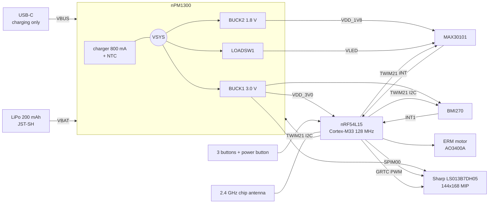

# orbit-watch rev A hardware

Status: **schematic-as-code done and checked (✅); PCB placement and routing not done (⏳).**
Nothing on this page has been built or measured yet.

The schematic is the Python file [`hardware/schematic/orbit_watch.py`](../hardware/schematic/orbit_watch.py)
(SKiDL). Running it writes, into [`hardware/out/`](../hardware/out/):

| file | what it is |
|---|---|
| `orbit_watch.net` | KiCad netlist. Import it into Pcbnew to start the layout |
| `bom.csv` | grouped BOM: refs, value, MPN, manufacturer, KiCad footprint, datasheet, pin-map source |
| `erc.txt` | SKiDL electrical rules check (0 messages at the time of writing) |
| `design_checks.txt` | project checks: rail voltages against each pin's datasheet range, decoupling, I2C pull-ups and addresses, nRF54L15 pin-function rules, footprint pads (0 failures, 4 warnings) |
| `pinout.md` | nRF54L15 pin assignment table |

KiCad is not installed on the development machine, and SKiDL cannot yet draw a KiCad 9
schematic for symbols it does not have graphics for. So there is **no `.kicad_sch` and no
`.kicad_pcb` in this repository**, and none were written by hand. CI imports the netlist's
footprints in the official `kicad/kicad` Docker image (see [CI](#what-ci-checks)).

## Block diagram

## Why these parts

**MCU: nRF54L15 rather than ESP32-S3.** A watch spends almost all of its life asleep, so sleep
current dominates. The nRF54L15 datasheet gives 2.9 µA for System ON idle with the GRTC
running from the 32.768 kHz crystal and all 256 KB of RAM retained (1.9 µA with 128 KB). The
ESP32-S3's state-keeping light sleep draws hundreds of µA according to Espressif's datasheet
(not re-checked for this page); its deep sleep is lower but loses most state, and its Wi-Fi
radio is not useful on a wrist. The nRF54L15 also has
BLE 6, a Cortex-M33 with TrustZone and PSPLIM stack limits (which this kernel uses), 1.5 MB of
RRAM, and a 52-bit always-on GRTC with a PWM output pin that can toggle the display's VCOM with
no CPU involvement. Its QFN48 package is hand-solderable with a stencil. The ESP32-S3 would have
been the choice for an AMOLED with a big frame buffer (8 MB PSRAM, more than 200 MHz). For a
memory LCD it is the wrong trade.

**Display: Sharp LS013B7DH05 Memory-in-Pixel** (1.26", 144 x 168, reflective). Every pixel has
its own 1-bit memory, so a static image costs almost nothing (Sharp's brochure gives 60 µW; a
later preliminary sheet gives 25 µW). Any subset of lines can be rewritten over SPI. That is
what the firmware's partial refresh exploits. An AMOLED would need its full frame rewritten or
its own controller RAM, and it draws milliamps whenever pixels are lit. The Sharp datasheet used
here (LD-26912A, the copy hosted by Adafruit) is for the `DH05`. Its pin table, timing and SPI
protocol drove both the connector wiring and `firmware/display/mip.c`.

**PMIC: nPM1300.** It integrates the charger (JEITA, NTC), two 200 mA bucks, two load
switches, a fuel-gauge ADC, ship and hibernate modes and USB-C CC detection, all on the same I2C
bus as the sensors, and Nordic documents it with the nRF54L15. BUCK1 makes 3.0 V for everything
that is always on. BUCK2 makes 1.8 V only for the MAX30101's analog supply, so firmware can switch it off
between readings. LOADSW1 feeds the PPG LEDs from VSYS (MAX30101 VLED+ needs at least 3.1 V, more
than the 3.0 V rail).

**IMU: Bosch BMI270.** Its accelerometer low-power mode goes down to 4 µA (datasheet). It has a
2 KB FIFO with a watermark interrupt, so the MCU wakes once per batch instead of once per sample.
The firmware does its own step counting on raw samples. It does not use Bosch's step-counter
feature.

**PPG: MAX30101.** The LEDs, photodiode and 18-bit ADC are in one 5.6 x 3.3 mm optical module,
so no optical stack has to be designed. The firmware uses the green LED (best for wrist HR),
50 samples/s averaged 2x in the FIFO to 25 samples/s, and does its own filtering and beat
detection.

## Power tree and rails

| net | source | consumers | nominal |
|---|---|---|---|
| VBUS | USB-C | nPM1300 VBUS (TVS: TPD1E10B06) | 5 V |
| VBAT | LiPo via JST-SH | nPM1300 VBAT (10 k NTC on board) | 3.0 to 4.2 V |
| VSYS | nPM1300 power path | BUCK inputs (PVDD), LOADSW1, charge LED | about VBAT |
| VDD_3V0 | BUCK1 | nRF54L15, LCD VDD/VDDA, BMI270, I2C pull-ups, motor | 3.0 V |
| VDD_1V8 | BUCK2 | MAX30101 VDD | 1.8 V |
| VLED | LOADSW1 (from VSYS) | MAX30101 VLED+ | VSYS |

Checks in `design_checks.txt`: every supply pin's rail is within that pin's datasheet range
(nRF54L15 VDD 1.7 to 3.6 V, LCD 2.7 to 3.3 V, BMI270 VDD 1.71 to 3.6 V, MAX30101 VDD 1.7 to
2.0 V, ...). One known exception is flagged as a warning: VLED can sag below the MAX30101's
3.1 V minimum when the battery is nearly flat, so firmware should only measure HR above about
3.3 V of VBAT. The MAX30101's SDA/SCL/INT idle at 3.0 V while its VDD is 1.8 V. The
datasheet's absolute maximum for those pins is 6.0 V, but its VIH has to be confirmed on the
bench.

## nRF54L15 pin map

Chosen with the nRF54L15 datasheet's QFN48 pin table and its rules. The generated table is
[`hardware/out/pinout.md`](../hardware/out/pinout.md).

| function | pin | why there |
|---|---|---|
| LCD SCLK / SI | P2.01 / P2.02 | SPIM00's dedicated fast pins (P2.01 is clock-capable) |
| LCD SCS / DISP | P2.05 / P2.00 | GPIO in the same domain; SCS is active-high, so it is driven as a GPIO |
| LCD EXTCOMIN | P0.03 | the GRTC PWM output: 1 Hz VCOM toggling with the CPU asleep |
| I2C SCL / SDA | P1.11 / P1.12 | TWIM21 lives in the P1 domain |
| BMI270 INT1, MAX30101 INT, nPM1300 GPIO0 | P1.13, P1.14, P1.10 | wake sources must have SENSE/GPIOTE (port 2 has neither) |
| buttons | P1.04 to P1.06 | same reason; internal pull-ups |
| motor gate | P1.07 | PWM20 in the P1 domain |
| 32.768 kHz crystal | P1.00 / P1.01 | fixed XL1/XL2 pins |
| debug UART | P0.00 / P0.01 | test pads only; the console is normally RTT over SWD |
| SWD + SWO | SWDIO, SWDCLK, nRESET, P2.07 | Tag-Connect TC2030 footprint |

## Where each pin-out came from

| part | source | status |
|---|---|---|
| nRF54L15-QFAA | Nordic datasheet, "QFN48 (QFAA) package pin assignments" | typed from the table |
| nPM1300-QEAA | Nordic PS, "QFN32 pin assignments" | typed from the table |
| BMI270 | BST-BMI270-DS000-08, table 22 | typed from the table |
| MAX30101 | ADI/Maxim datasheet, pin description | typed from the table |
| LS013B7DH05 | Sharp LD-26912A, table 4-1 | typed from the table; FPC contact side still to check |
| passives, crystals, connectors, buttons, antenna | official KiCad footprints | pad names verified by `tools/fetch_kicad_pads.py` |
| AO3400A (G/S/D = 1/2/3), TC2030 mapping | from memory | **verify before ordering** |

Footprint exposed-pad sizes (QFN48 EP 4.6 mm, QFN32 EP 3.45 mm) are the closest official KiCad
footprints. Check them against the package drawings before layout. The nPM1300 VSET resistors
(R1, R2) are marked `TBD` on purpose: their values come from the VSET table in the nPM1300
product specification, which I did not transcribe. The RF matching values (2.7 nH, 1.5 pF, one
shunt DNP) are starting points from Nordic's reference BOM and must be tuned on the real layout
with a VNA.

## Placement notes (for the person doing the layout)

Target outline: about 36 x 40 mm, 4 layers (signal / solid GND / power / signal), 0.8 mm board
so the stack-up fits a watch case.

1. **Top side: display connector and buttons.** Put the FH12 FPC connector on the edge under the
   panel's tail. Put the three EVQ-P7A side switches on the right edge and the power switch on the
   left, with their actuators flush with the outline.
2. **Bottom side: MAX30101**, centred, facing the skin, with nothing taller than it within 3 mm
   (the case needs an optical window and a light barrier between LED and photodiode). Keep its
   VLED+ decoupling (C24 10 µF + 100 nF) within 2 mm of pins 9/10.
3. **nRF54L15 near the antenna edge.** Chip antenna AE1 on a board corner with the keep-out
   from Johanson's datasheet (no copper on any layer under it). Short, 50 Ω coplanar feed from
   ANT (pin 31) through L4/C16/C17. DECA/DECRF/DECD capacitors and L3 (DC/DC) as close to their
   pins as possible: follow Nordic's reference layout for the QFAA package.
4. **Crystals.** Y1 (32 MHz) within 3 mm of XC1/XC2, with GND guard and no traces under it. Y2
   (32.768 kHz) next to P1.00/P1.01, away from the buck inductors.
5. **nPM1300 + inductors** on the opposite side of the board from the antenna. Keep the SW1/SW2
   loops tight: L1/L2 and the output capacitors next to pins 3/5, PVDD capacitor at pin 4.
   Route VBAT and VSYS as short wide pours. Place the NTC RT1 next to the battery connector, or
   use a cell with its own NTC lead.
6. **BMI270** near the board centre (less bending stress), away from the motor. Its axes should
   be aligned with the case edges.
7. **Motor connector J5 and Q1/D3** near the case edge opposite the antenna. The motor current
   (about 80 mA) should return through its own GND path to the buck output capacitor.
8. **Test pads**: VBAT, VSYS, VDD_3V0, VDD_1V8, GND, UART TX/RX, and the TC2030 footprint,
   all on the bottom side, reachable with the battery unplugged.

## Layout checklist

- [ ] Re-check every pin number of U1 to U4 and J4 against the datasheets (the netlist uses them as is)
- [ ] Confirm the QFN exposed-pad sizes and paste reduction (use the footprints' thermal-via variants for the PMIC)
- [ ] Choose R1/R2 from the nPM1300 VSET table (3.0 V, 1.8 V)
- [ ] Confirm the AO3400A pin-out and the TC2030 pin mapping (marked "memory" above)
- [ ] Antenna keep-out on all layers; RF feed impedance computed for the chosen stack-up
- [ ] Ground stitching vias along the board edge and around the RF section
- [ ] DECA/DECD/DCC components placed per Nordic's QFAA reference layout
- [ ] Buck loops: input cap, switch node, inductor, output cap in a tight loop on the top layer
- [ ] MAX30101 optical window, light barrier, and nothing tall nearby
- [ ] FPC connector orientation vs the panel tail (contacts top or bottom) checked against LD-26912A fig. 8-1
- [ ] Button actuator heights against the case drawing
- [ ] DRC clean with the fab's rules; 3D model check with the case
- [ ] Generate gerbers, drill, pick-and-place and the 3D renders (KiCad: View > 3D Viewer > Render)

## What CI checks

* `python hardware/schematic/orbit_watch.py` runs SKiDL's ERC and the design checks, and writes
  the netlist and BOM (also run by `pytest`).
* The `kicad` job runs inside the official `kicad/kicad` Docker image. There
  `tools/fetch_kicad_pads.py --lib-dir /usr/share/kicad/footprints --check` confirms that every
  footprint named in the BOM exists in the installed official library with the expected pads.
  `tools/kicad_netlist_check.py` loads every footprint with KiCad's own `pcbnew` Python module
  and checks that each netlist pin lands on a pad. This job has not been run yet: it runs on the
  first CI push and is marked experimental until then.

What CI does **not** do: draw the schematic, place or route the PCB, run DRC on a board, or
render it in 3D. Those are listed under hardware validation.
