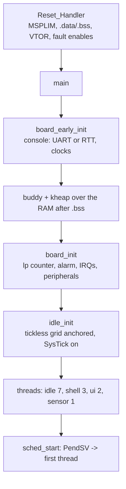

# The orbit-watch kernel

orbit-watch's kernel is derived from [orbit-os](https://github.com/coopersimpson101-debug/orbit-os)
(an AArch64 kernel for the Raspberry Pi 5) and ported to a Cortex-M33 microcontroller.

| piece | from orbit-os | what changed |
|---|---|---|
| `lib/kprintf.c`, `lib/kstring.c`, `lib/shell_parse.c`, `include/list.h` | verbatim | none |
| `kernel/runqueue.c` (8-level bitmap run-queue) | verbatim | none |
| `mm/buddy.c`, `mm/kheap.c` | page size, order count and slab classes are now compile-time options | 1 KiB pages, orders 0..7 (1 to 128 KiB), 16 to 512 B slab classes on the MCU |
| scheduler (`kernel/sched.c`, `arch/cm33/context.S`) | design only: priority round-robin, sleep queue, preemption | rewritten for M-profile: PendSV switch, PSP/MSP split, PSPLIM, event flags |
| everything else | - | new: tickless idle, PM policy, timer queue, MIP driver, watch app, sensors, boards |

The orbit-os tests for those modules are kept too (`tests/test_buddy.c` etc., unchanged), and
`tests/test_mm_mcu.c` covers the MCU configuration.

## Boot and threads



* Threads run in Thread mode on the PSP. Exceptions use the MSP. Everything runs Secure on both
  targets: there is no TrustZone partition yet.
* **Context switch** (`context.S`): exception entry has already stacked r0 to r3, r12, lr, pc
  and xPSR. PendSV pushes r4 to r11 and EXC_RETURN, calls `sched_switch_hook()` and unstacks the
  next thread the same way. PendSV has the lowest priority, so it never preempts an interrupt
  handler.
* **Stack overflow protection**: each thread's PSPLIM is set to the bottom of its stack (plus
  a 32-byte guard), so an overflow raises a UsageFault (STKOF). The fault handler reports it
  instead of letting it corrupt the neighbouring stack. Stacks come from the buddy allocator
  and are pre-filled, so `ps` reports a high-water mark.
* **Blocking**: `ev_wait(mask, timeout)` and `ev_post(thread, bits)` (event flags, ISR-safe),
  `thread_sleep()`, and kernel timers (`timerq.c`, a sorted list, FIFO for equal expiries;
  periodic timers that miss periods realign to their grid instead of firing in a burst).

## Tickless idle

The kernel counts ticks at `OW_HZ` = 100 Hz. While something is running, SysTick produces
them. When only the idle thread is runnable, idle does this (`kernel/idle.c`):

1. With PRIMASK set (WFI still wakes on a pending interrupt), it asks for the next timer
   expiry $k_{next}$ and the deepest state worth entering (`pm_select`, below).
2. It stops SysTick and programs the low-power counter compare for tick $k_{next}$. On the
   nRF54L15 this is the GRTC (1 MHz SYSCOUNTER, 52 bits). On the AN505 model it is the 32 kHz
   S32K timer, plus a one-shot CMSDK timer as the compare.
3. It runs WFI, with SLEEPDEEP set for `PM_DEEP`.
4. On wake-up it recomputes the **absolute** tick from the counter, runs the expired timers, and
   restarts SysTick so that its first period ends exactly on the next tick boundary.

The time accounting (`kernel/tickless.c`) slaves kernel time to the low-power counter. One fixed
anchor $L_0$ (the counter value at boot) defines every tick boundary:

$$ \mathrm{lp}(k) = L_0 + \left\lfloor \frac{k \, f_{lp}}{f_{tick}} \right\rfloor $$

So the fractional part of $f_{lp}/f_{tick}$ (327.68 counter cycles per tick for a 32.768 kHz
counter at 100 Hz) never accumulates. An earlier version re-anchored at every sleep. The soak
test showed that it lost up to one counter cycle per sleep (`tests/test_tickless.c` now asserts
zero drift over 448,845 random sleeps). On wake-up, with the counter at $L$, the kernel is in tick

$$ k = \max\{k : \mathrm{lp}(k) \le L\} = \left\lfloor \frac{(L - L_0 + 1)\, f_{tick} - 1}{f_{lp}} \right\rfloor $$

and SysTick restarts with a first period of $\mathrm{lp}(k+1) - L$ counter cycles, converted
to CPU cycles. Taking $\max(k_{kernel}, k)$ also absorbs any drift of the CPU clock during busy
periods. Kernel time never runs backwards. Narrow counters (24-bit RTC, 32-bit timer) are
unwrapped with modular differences, so `max_idle` is clamped to half the wrap period. An
interrupt that wakes the CPU early (button, UART) is simply credited fewer ticks.
`wake_latency_lp` makes the compare fire early enough for the clock to start up.

The tests check, over hours of simulated time for four counter configurations (32.768 kHz/24
bit, a non-integer 32768/128, the GRTC at 1 MHz/52 bit, 25 MHz/32 bit), that after every
sleep $\mathrm{lp}(k) \le L < \mathrm{lp}(k+1)$ and that the restarted tick lands exactly on
the global grid.

## Power states

`kernel/pm.c` picks the deepest state whose break-even time fits before the next event:

| state | what it is on nRF54L15 | min residency + exit latency | wake sources | forbidden by |
|---|---|---|---|---|
| `PM_IDLE` | WFI, SysTick running | 0 | everything | - |
| `PM_TICKLESS` | System ON idle, tick suppressed, GRTC compare | 20 ms + 50 µs | GRTC, buttons, IMU, PPG, UART, PMIC | - |
| `PM_DEEP` | SLEEPDEEP: HF clock off, UART RX off | 200 ms + 1 ms | GRTC, buttons, IMU INT1, PMIC | console, SPI DMA, PPG session locks |
| `PM_OFF` | System OFF (RAM lost, button resets) | explicit only (`poweroff`) | button | - |

The residency and latency numbers are design targets to tune on hardware, not measurements.
Drivers take locks (`pm_lock(PM_LOCK_SPI)` around a display transfer, `PM_LOCK_PPG` during a
heart-rate session) to keep the system out of states that would stop their clocks.

## Display: partial refresh on a memory LCD

`display/mip.c` implements the LS013B7DH05 protocol from Sharp's datasheet (LD-26912A §6-6).
A multi-line update is

```
[M0 M1 M2 + 5 dummy] { [AG0..AG7 line address, LSB first] [144 data bits] [8 dummy] } x n  [8 dummy]
```

so an update of $n$ lines costs $2 + 20n$ bytes, and a full frame costs 3,362 bytes. The panel
keeps every pixel in its own memory, so lines that are not sent stay as they were. The driver
uses that twice:

1. Every drawing primitive (`display/gfx.c`) marks the rows it touches in a 168-bit dirty map.
   The watchface redraws only the widgets whose value changed.
2. At flush time each dirty row is compared with a shadow copy of what the panel already holds.
   Rows redrawn with identical pixels are dropped. For example, the seconds digit "1" in "31"
   is unchanged when the display moves to "32".

The same file contains a reference **decoder**: a bit-level model of the panel's pixel memory,
driven by the SPI byte stream exactly as the datasheet timing charts describe (mode bits,
LSB-first gate address, 144 data bits, dummy clocks). Host tests check the encoder against
the datasheet's bit tables (line 1 = `10000000`, line 168 = `00010101`) and against the decoder.
The QEMU board feeds every frame the firmware sends through this decoder (the "virtual panel")
and dumps the result as a PBM image. That is where the README's watchface picture comes from.

VCOM: the panel needs its common electrode inverted at about 1 Hz or more. With EXTMODE tied
high, the nRF54L15's GRTC PWM output on P0.03 drives EXTCOMIN in hardware, so this costs no
CPU wake-ups. `mip_encode_vcom()` implements the alternative for EXTMODE=L wiring (M1 flag).

## Step counter

`app/steps.c`, integer-only, 25 Hz accelerometer input in mg:

1. $a = \lfloor\sqrt{a_x^2 + a_y^2 + a_z^2}\rfloor$ (bit-by-bit integer square root): the
   magnitude does not depend on how the watch is oriented.
2. Gravity removal with a first-order IIR, $d \leftarrow d + (a - d)/32$ (time constant about
   1.3 s at 25 Hz), then $x = a - d$.
3. A 4-tap moving average.
4. Peak picking with an adaptive threshold: an envelope $e \leftarrow e - e/32$,
   $e \leftarrow \max(e, |x|)$, and threshold $\theta = \max(e/2, 40\,\mathrm{mg})$. A peak counts
   only after the signal has dipped below $-\theta/4$ since the last one (hysteresis).
5. A timing gate: 0.25 s ≤ step interval ≤ 2 s.
6. A regularity gate: the first 4 steps of a bout are held back and committed together only if
   their intervals agree within ±50 %. A gap over 2 s ends the bout, so isolated arm swings
   never start one.

This follows the general "peak + adaptive threshold + regularity window" pedometer approach (e.g.
N. Zhao, *Full-Featured Pedometer Design Realized with 3-Axis Digital Accelerometer*, Analog
Dialogue 44-06, 2010). The implementation and constants are this project's.

## Heart rate from PPG

`app/hr.c`, integer-only, 25 Hz:

1. Invert the signal (more blood means more absorption, which means fewer ADC counts).
2. Band-pass 0.5 to 4 Hz (30 to 240 bpm) with two 2nd-order Butterworth sections, designed by
   `tools/design_filters.py` with the bilinear transform and frequency pre-warping:
   $\omega_a = 2 f_s \tan(\pi f_c / f_s)$, $s = 2 f_s \frac{1 - z^{-1}}{1 + z^{-1}}$. They run
   in direct form I with Q28 coefficients and 64-bit accumulators. The measured response is -3 dB
   at 0.5 Hz and 4 Hz, and -28 dB at 0.1 Hz.
3. Beat detection: a local maximum above 0.45 times a decaying amplitude envelope, with a 0.3 s
   refractory period.
4. Sub-sample timing: a parabola through the three samples around the peak puts its apex at an
   offset $\delta = \frac{y_{-1} - y_{+1}}{2(y_{-1} - 2y_0 + y_{+1})}$ samples, stored in 1/256
   sample units. At 25 Hz this turns 40 ms timing steps into an interpolated estimate.
5. Inter-beat-interval gating: accept 0.3 to 2 s and within 30 % of the running median. An
   interval about twice the median counts as a missed beat. Four rejections in a row reset the
   history.
6. Output $60 / \mathrm{median}(\text{last 8 IBIs})$ once at least 4 intervals are held. The
   reading is withheld when the DC level says there is no skin in front of the sensor, or when
   the pulse amplitude is too small.

It is tested on synthetic PPG (`app/synth.c`: systolic and dicrotic Gaussian pulses, ±2.3 %
beat-to-beat variability, respiratory amplitude modulation, baseline wander, noise) and on 8
real fingertip PPG excerpts from the BIDMC dataset ([data/bidmc](../data/bidmc/README.md)). The
latter are clean ICU recordings, not wrist PPG during motion. Motion-artifact rejection
(using the accelerometer) is on the roadmap.

## Memory map

| | AN505 (QEMU) | nRF54L15 |
|---|---|---|
| code | 0x1000_0000 (SSRAM1, Secure alias) | 0x0000_0000 RRAM |
| RAM | 0x3800_0000, 256 KiB (SSRAM2, Secure alias) | 0x2000_0000, 256 KiB |
| MSP stack | top 4 KiB of RAM, MSPLIM set | same |
| heap | end of `.bss` to MSP stack: about 229 KiB in 1 KiB pages | same |
| image | about 25 KiB | about 24 KiB |
